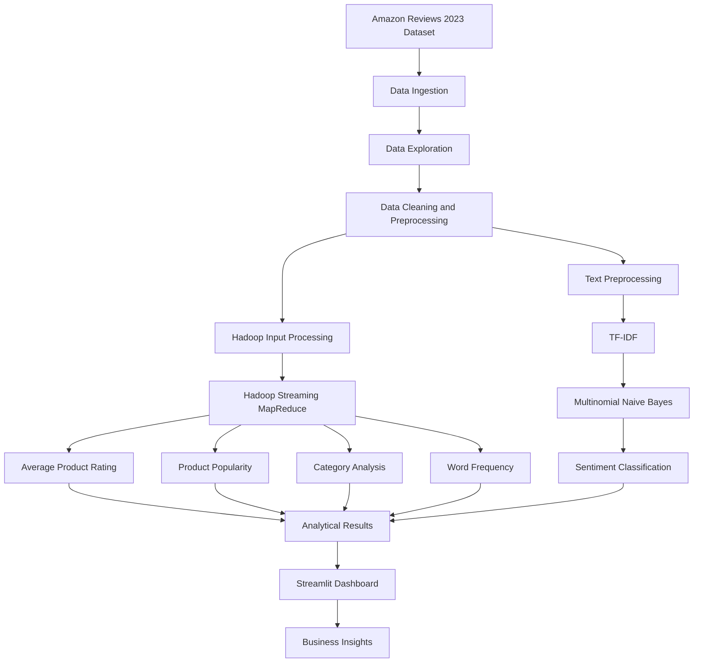
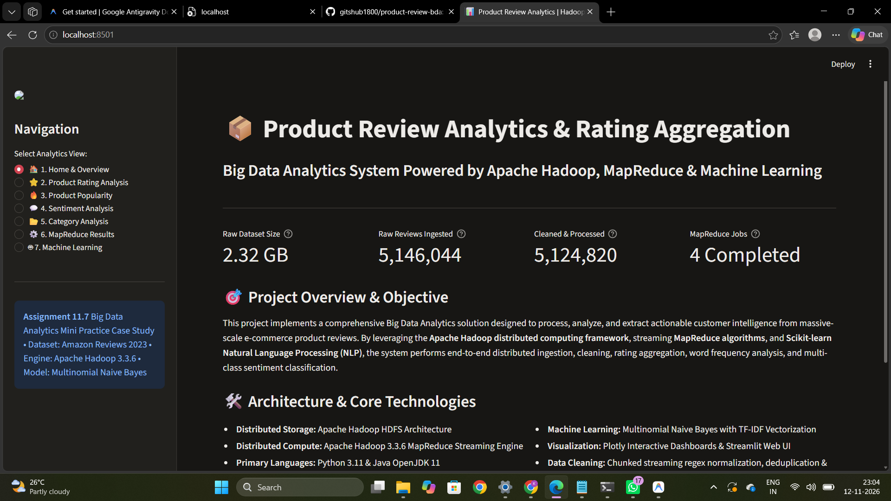
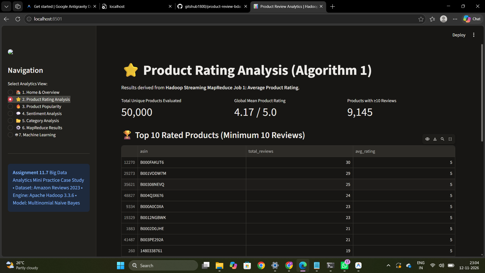
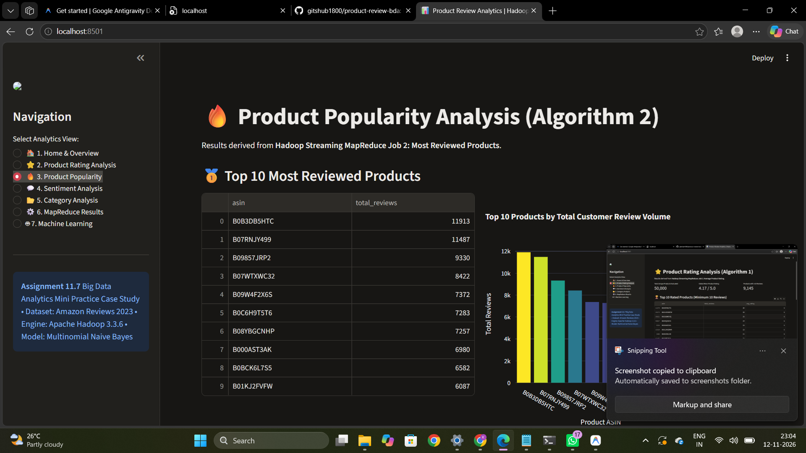
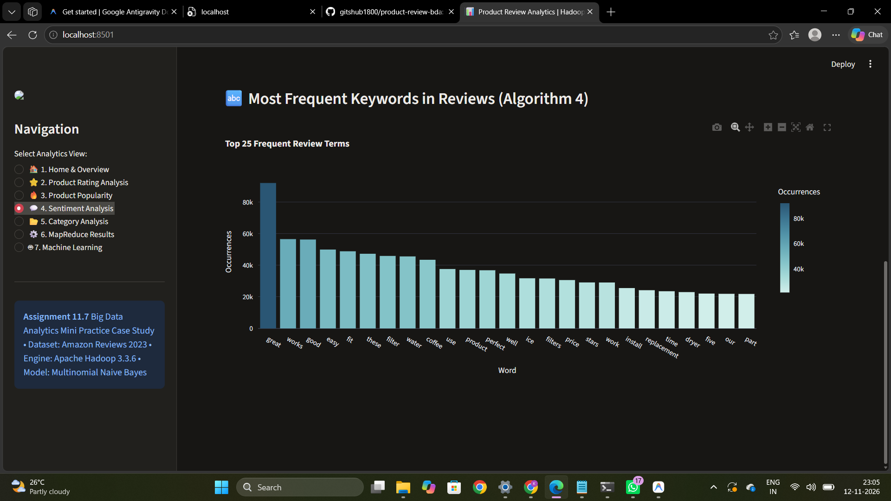
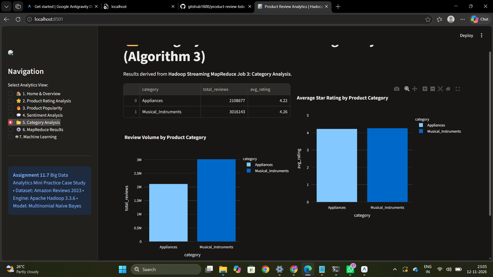
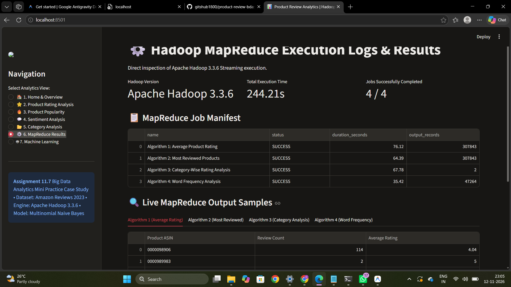
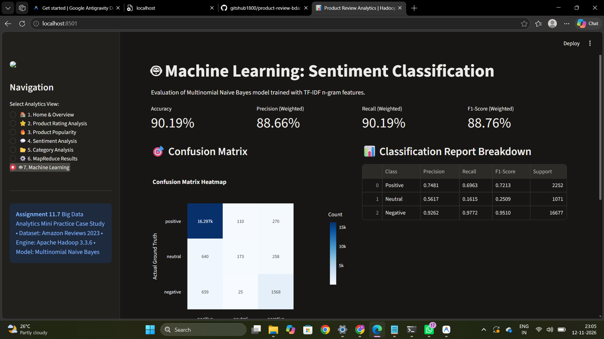

# 🛒 Product Review Analytics and Rating Aggregation Using Hadoop and MapReduce

<p align="center">
  <strong>Transforming Millions of Customer Reviews into Meaningful Business Insights</strong>
</p>

<p align="center">
  
  
  
  
  
</p>

---

**📚 Assignment Number:** 11.7

**🎓 Course:** Big Data Analytics (BDA) Mini Practice Case Study

**📦 Dataset:** Amazon Reviews 2023 (McAuley Lab, UCSD) — 2.316 GB Downloaded, 5,146,044 Real Customer Reviews

**⚙️ Framework:** Apache Hadoop 3.3.6 (HDFS & MapReduce Streaming) and Scikit-learn (Multinomial Naive Bayes)

---

## 📑 Table of Contents

1. [Project Overview](#1-project-overview)
2. [Project Objectives](#2-project-objectives)
3. [Technologies Used](#3-technologies-used)
4. [Dataset Description](#4-dataset-description)
5. [Project Workflow](#5-project-workflow)
6. [Hadoop MapReduce Analysis](#6-hadoop-mapreduce-analysis)
7. [Machine Learning – Sentiment Classification](#7-machine-learning--sentiment-classification)
8. [Interactive Dashboard](#8-interactive-dashboard)
9. [Results and Performance Analysis](#9-results-and-performance-analysis)
10. [Visual Dashboard & Output Screenshots](#10-visual-dashboard--output-screenshots)
11. [Project Folder Structure](#11-project-folder-structure)
12. [Installation and Setup](#12-installation-and-setup)
13. [Project Execution](#13-project-execution)
14. [Conclusion](#14-conclusion)
15. [Future Enhancements](#15-future-enhancements)
16. [Repository and Documentation](#16-repository-and-documentation)

---

## 1. 📌 Project Overview

Product Review Analytics is an end-to-end Big Data Analytics project designed to process, analyze and extract meaningful insights from millions of Amazon customer reviews.

The project integrates **Apache Hadoop, MapReduce and Machine Learning** to perform large-scale review processing, product rating aggregation, popularity analysis, category-wise analysis and sentiment classification.

An interactive **Streamlit dashboard** presents the analytical results through charts, tables, performance metrics and visualizations.

### 📊 Project Highlights

| Parameter | Details |
|:---|:---|
| Dataset | Amazon Reviews 2023 |
| Dataset Size | 2.316 GB |
| Raw Reviews | 5,146,044 |
| Cleaned Reviews | 5,124,820 |
| MapReduce Algorithms | 4 |
| ML Algorithm | Multinomial Naive Bayes |
| Dashboard | Streamlit + Plotly |

---

## 2. 🎯 Project Objectives

- Process large-scale customer reviews using Big Data technologies.
- Implement data processing using Hadoop MapReduce.
- Calculate average product ratings.
- Identify the most-reviewed products.
- Perform category-wise rating analysis.
- Extract frequently occurring words from reviews.
- Perform sentiment classification using Machine Learning.
- Evaluate classification performance.
- Develop an interactive analytical dashboard.
- Generate meaningful business insights.

---

## 3. 🛠️ Technologies Used

| Technology | Purpose |
|:---|:---|
| Python 3.11 | Core programming |
| Apache Hadoop 3.3.6 | Big Data processing |
| HDFS | Distributed storage, if implemented |
| Hadoop Streaming | Mapper and Reducer execution |
| Java OpenJDK 11 | Hadoop runtime |
| Pandas | Data manipulation |
| NumPy | Numerical computation |
| Scikit-learn | Machine Learning |
| TF-IDF | Text feature extraction |
| Multinomial Naive Bayes | Sentiment classification |
| Streamlit | Dashboard development |
| Plotly | Interactive visualization |

---

## 4. 📂 Dataset Description

### 🌐 Dataset Source

**Amazon Reviews 2023 – McAuley Lab, UCSD**

🔗 [Official Dataset Website](https://amazon-reviews-2023.github.io/)

### 📋 Dataset Statistics

| Attribute | Value |
|:---|---:|
| Downloaded Dataset Size | 2.316 GB |
| Raw Reviews Ingested | 5,146,044 |
| Cleaned Reviews | 5,124,820 |
| Excluded Records | 21,224 |
| Dataset Domain | E-commerce |

### 📑 Dataset Attributes

- Product ID (ASIN)
- Customer Rating
- Review Text
- Review Title
- Product Category
- Review Timestamp
- Helpful Votes, where available

### 🧹 Data Preprocessing

1. Missing-value handling.
2. Duplicate removal.
3. Text normalization.
4. Data cleaning.
5. Invalid record handling.
6. Data transformation.

---

## 5. 🔄 Project Workflow

The project follows an end-to-end Big Data Analytics pipeline.

### 🏗️ System Architecture

<!-- Insert actual architecture diagram here -->



### ⚙️ Workflow Stages

1. Dataset Collection
2. Data Ingestion
3. Data Cleaning
4. Hadoop Processing
5. MapReduce Analytics
6. Machine Learning
7. Model Evaluation
8. Dashboard Visualization
9. Business Insights

---

## 6. 🔄 Hadoop MapReduce Analysis

Apache Hadoop MapReduce is used to perform large-scale analytical operations on product review records.

### 6.1 ⭐ Algorithm 1: Average Product Rating

**Objective:** Calculate the average customer rating for each product.

**Mapper:** Emits product ID and rating.

**Reducer:** Aggregates rating sums and review counts.

**Formula:**

\[
Average\ Rating = \frac{\sum Ratings}{Total\ Reviews}
\]

**Output:** Product-wise average ratings.

### 6.2 🔥 Algorithm 2: Most Reviewed Products

**Objective:** Identify the most popular products based on review count.

**Mapper:** Emits product ID and review count.

**Reducer:** Aggregates product review counts and prepares rankings.

**Output:** Top 10 most-reviewed products.

### 6.3 📂 Algorithm 3: Category-wise Rating Analysis

**Objective:** Compare product ratings and review volumes across categories.

**Mapper:** Emits category and rating information.

**Reducer:** Calculates category-wise review counts and average ratings.

**Output:** Category-wise analytical results.

### 6.4 🔤 Algorithm 4: Review Word Frequency

**Objective:** Identify frequently occurring words in customer reviews.

**Mapper:** Tokenizes review text and emits normalized words.

**Reducer:** Aggregates the frequency of each word.

**Output:** Most frequently occurring review terms.

---

## 7. 🤖 Machine Learning – Sentiment Classification

Machine Learning is used to classify customer reviews based on their sentiment.

### 7.1 Text Preprocessing

Prepare review text through cleaning, normalization and label preparation.

### 7.2 TF-IDF Feature Extraction

Convert textual reviews into numerical feature vectors using Term Frequency–Inverse Document Frequency.

### 7.3 Multinomial Naive Bayes

Apply Multinomial Naive Bayes to classify review sentiments based on extracted text features.

### 7.4 Model Training and Testing

Explain the actual training dataset, testing dataset and model configuration.

### 7.5 Model Evaluation

| Metric | Description |
|:---|:---|
| Accuracy | Overall correct predictions |
| Precision | Correct positive predictions |
| Recall | Correctly identified actual positives |
| F1-Score | Harmonic mean of precision and recall |
| Confusion Matrix | Actual vs predicted classes |

**Insert actual model evaluation results here.**

---

## 8. 📊 Interactive Dashboard

The Streamlit application provides seven analytical sections.

### 8.1 🏠 Home & Overview

Displays project introduction, dataset statistics, KPIs and system information.

### 8.2 ⭐ Product Rating Analysis

Displays average ratings, rating distributions and top-rated products.

### 8.3 🔥 Product Popularity Analysis

Identifies the most-reviewed products and compares review volumes.

### 8.4 💬 Sentiment Analysis

Displays review keyword analysis and available sentiment visualizations.

### 8.5 📂 Category Analysis

Presents category-wise review volumes and average ratings.

### 8.6 ⚙️ Hadoop MapReduce Results

Displays MapReduce execution details, output records and processing statistics.

### 8.7 🤖 Machine Learning Results

Displays model performance metrics, classification report and confusion matrix.

---

## 9. 📈 Results and Performance Analysis

### 9.1 Dataset Processing Statistics

| Metric | Result |
|:---|---:|
| Raw Reviews | 5,146,044 |
| Cleaned Reviews | 5,124,820 |
| Excluded Records | 21,224 |
| Dataset Size | 2.316 GB |

### 9.2 MapReduce Execution Performance

| Algorithm | Execution Time | Status |
|:---|:---|:---|
| Average Product Rating | Actual result | Verify |
| Most Reviewed Products | Actual result | Verify |
| Category-wise Analysis | Actual result | Verify |
| Word Frequency Analysis | Actual result | Verify |

### 9.3 Machine Learning Performance

Include actual accuracy, precision, recall, F1-score and confusion matrix.

### 9.4 Key Analytical Findings

Explain the actual observations obtained from the completed analysis.

---

## 10. 📸 Visual Dashboard & Output Screenshots

The following screenshots showcase the actual outputs generated by the Product Review Analytics system.

### 10.1 🏠 Home & Project Overview



**Description:** Overall project overview, dataset statistics and key performance indicators.

### 10.2 ⭐ Product Rating Analysis



**Description:** Average ratings and top-rated products.

### 10.3 🔥 Product Popularity Analysis



**Description:** Most-reviewed products and popularity rankings.

### 10.4 💬 Sentiment Analysis



**Description:** Review keywords and sentiment visualizations.

### 10.5 📂 Category Analysis



**Description:** Category-wise review volume and rating comparisons.

### 10.6 ⚙️ Hadoop MapReduce Results



**Description:** Hadoop execution details and MapReduce outputs.

### 10.7 🤖 Machine Learning Results



**Description:** Model evaluation and confusion matrix.

---

## 11. 📁 Project Folder Structure

```text
Product-Review-Analytics/
│
├── dataset/
│   ├── raw/
│   └── processed/
│
├── src/
│   ├── preprocessing/
│   ├── mapreduce/
│   ├── analytics/
│   └── machine_learning/
│
├── models/
├── results/
├── dashboard/
├── screenshots/
│
├── README.md
├── COMPREHENSIVE_MASTER_GUIDE.md
├── PROJECT_PREPARATION_GUIDE.md
├── requirements.txt
└── .gitignore
```

*Update this tree to match the actual project files.*

---

## 12. 🚀 Installation and Setup

### 12.1 Prerequisites

- Python 3.11
- Java OpenJDK 11
- Apache Hadoop 3.3.6
- Required Python libraries

### 12.2 Install Dependencies

```bash
pip install -r requirements.txt
```

### 12.3 Hadoop Configuration

Explain the actual Hadoop configuration and environment setup.

---

## 13. ▶️ Project Execution

### 13.1 Clone Repository

```bash
git clone YOUR_GITHUB_REPOSITORY_URL
```

### 13.2 Navigate to Project

```bash
cd Product-Review-Analytics
```

### 13.3 Dataset Preparation

Follow the dataset download and extraction instructions.

### 13.4 Execute Preprocessing

Run the actual preprocessing script.

### 13.5 Execute MapReduce Jobs

Run all four Hadoop Streaming jobs.

### 13.6 Train Machine Learning Model

Execute the sentiment classification pipeline.

### 13.7 Launch Dashboard

```bash
streamlit run YOUR_ACTUAL_DASHBOARD_FILE.py
```

---

## 14. 🏁 Conclusion

The Product Review Analytics project demonstrates the use of Big Data technologies and Machine Learning to analyze large-scale e-commerce customer reviews.

By combining Hadoop MapReduce, text analytics, sentiment classification and interactive visualization, the system converts millions of customer reviews into meaningful analytical results and business insights.

---

## 15. 🔮 Future Enhancements

- Real-time review processing.
- Advanced sentiment classification models.
- Product recommendation systems.
- Cloud-based distributed deployment.
- Interactive product search.
- Automated analytical reporting.
- Advanced customer behavior analytics.

---

## 16. 📚 Repository and Documentation

| File | Description |
|:---|:---|
| `README.md` | Main project documentation |
| `COMPREHENSIVE_MASTER_GUIDE.md` | Detailed technical explanation |
| `PROJECT_PREPARATION_GUIDE.md` | Project presentation and viva preparation |
| `requirements.txt` | Python dependencies |
| `.gitignore` | Files excluded from Git |

**Project:** Product Review Analytics and Rating Aggregation Using Hadoop and MapReduce

**Assignment:** 11.7 – Big Data Analytics Mini Practice Case Study

**Author:** Add your name

**Institution:** Add your institution name

---

<p align="center">
  <strong>⭐ Transforming Customer Reviews into Meaningful Business Insights ⭐</strong>
</p>
